# Rollup 构建基石：打包配置与插件机制实战

## 核心主旨

<word text="Rollup"/> 是一款基于 <word text="ESM"/> 模块规范实现的 <word text="JavaScript"/> 打包工具，既是 <word text="Vite"/> 生产环境下的核心打包引擎，其插件机制也被 <word text="Vite"/> 完整兼容，堪称 <word text="Vite"/> 的构建基石。

本文把「基础使用」与「插件机制」两大部分合并为一条完整的知识链路：先从零跑通一次打包，掌握 `input`、`output`、`external`、`plugins` 等核心配置与 <word text="JavaScript API"/> 的编程式调用；再深入 <word text="Rollup"/> 的 <word text="Build 阶段"/> / <word text="Output 阶段"/> 两大构建生命周期，拆解 <word text="Hook"/> 的五种执行类型与完整工作流；最后以官方插件源码为范例，实战 `resolveId`、`load`、`transform`、`renderChunk`、`generateBundle` 五个高频 <word text="Hook"/>，建立可独立编写 <word text="Rollup 插件"/> 的能力。

## Rollup 在 Vite 架构中的定位

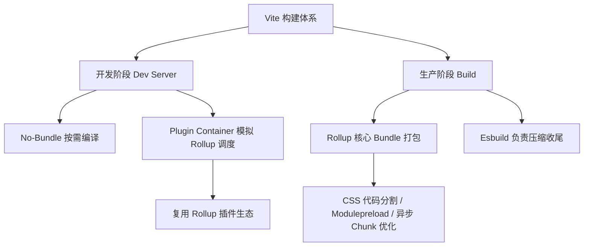

<word text="Vite"/> 之所以能在生态上实现「降维打击」，正是因为直接兼容了 <word text="Rollup"/> 积累多年的插件生态。理解 <word text="Rollup"/> 的配置与 <word text="Hook"/>，等同于拿到 <word text="Vite"/> 插件开发的通用语言。

## 快速上手：打出第一份产物

### 一、初始化项目

```bash [bash]
npm init -y
pnpm i rollup
```

目录结构如下：

```txt [目录结构]
.
├── package.json
├── pnpm-lock.yaml
├── rollup.config.js
└── src
    ├── index.js
    └── util.js
```

### 二、编写源码与配置

::: code-group

```javascript [src/index.js]
import { add } from './util'
console.log(add(1, 2))
```

```javascript [src/util.js]
export const add = (a, b) => a + b

export const multi = (a, b) => a * b
```

```javascript [rollup.config.js]
/**
 * @type { import('rollup').RollupOptions }
 */
const buildOptions = {
  input: ['src/index.js'],
  output: {
    dir: 'dist/es',
    format: 'esm',
  },
}

export default buildOptions
```

```json [package.json]
{
  "scripts": {
    "build": "rollup -c"
  }
}
```

:::

> `-c` 表示读取 `rollup.config.js` 中的配置；配置文件顶部的 `@type` 注释可让 VSCode 获得完整的类型提示。

### 三、执行构建

执行 `npm run build` 后，产物如下：

```javascript [dist/es/index.js]
// 代码已经打包到一起
const add = (a, b) => a + b

console.log(add(1, 2))
```

可以观察到 `util.js` 中的 `multi` 方法并未出现在产物中——这是 <word text="Rollup"/> 天然的 <word text="Tree Shaking"/> 能力。

### 四、Tree Shaking 的本质

所谓 Tree Shaking（摇树），是编译原理中 <word text="DCE"/>（Dead Code Elimination，消除无用代码）技术的一种实现。由于 <word text="ESM"/> 的依赖关系是静态确定的、与运行时状态无关，<word text="Rollup"/> 可以在编译阶段分析依赖关系，对 <word text="AST"/> 中未被引用的节点执行删除。

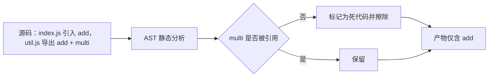

## 常用配置解读

### 一、多产物配置

类库场景通常需要同时暴露多种格式产物以兼顾兼容性。把 `output` 从对象改造为数组即可：

```javascript [rollup.config.js]
/**
 * @type { import('rollup').RollupOptions }
 */
const buildOptions = {
  input: ['src/index.js'],
  output: [
    { dir: 'dist/es', format: 'esm' },
    { dir: 'dist/cjs', format: 'cjs' },
  ],
}

export default buildOptions
```

数组中每个元素都是一个描述对象，分别决定一类产物的输出行为。

### 二、多入口配置

`input` 支持字符串、数组与对象三种形态，多入口与多产物通常组合使用：

```javascript [rollup.config.js]
// 数组形态
{
  input: ['src/index.js', 'src/util.js']
}

// 对象形态，key 即产物文件名
{
  input: {
    index: 'src/index.js',
    util: 'src/util.js',
  },
}
```

若不同入口需要不同的打包策略，可以直接默认导出一个「配置数组」：

```javascript [rollup.config.js]
const buildIndexOptions = { input: ['src/index.js'], output: [] }
const buildUtilOptions = { input: ['src/util.js'], output: [] }

export default [buildIndexOptions, buildUtilOptions]
```

<word text="Vite"/> 自身的源码打包就是典型的多配置场景，需要把项目代码拆分到不同部分、用不同配置分别打包。

### 三、自定义 output 配置

`output` 用来声明输出行为，常用配置项如下：

| 配置项           | 作用                                                          | 常用取值                                         |
| ---------------- | ------------------------------------------------------------- | ------------------------------------------------ |
| `dir`            | 产物输出目录                                                  | `path.resolve(__dirname, 'dist')`                |
| `entryFileNames` | 入口模块的输出文件名                                          | `[name].js`                                      |
| `chunkFileNames` | 非入口模块（如动态 import 产生的 <word text="Chunk"/>）文件名 | `chunk-[hash].js`                                |
| `assetFileNames` | 静态资源文件输出文件名                                        | `assets/[name]-[hash][extname]`                  |
| `format`         | 产物模块格式                                                  | `amd` / `cjs` / `es` / `iife` / `umd` / `system` |
| `sourcemap`      | 是否生成 <word text="SourceMap"/>                             | `true` / `false`                                 |
| `name`           | iife / umd 格式对外暴露的全局变量名                           | `MyBundle`                                       |
| `globals`        | 全局变量声明映射                                              | `{ jquery: '$' }`                                |

文件名类配置支持以下占位符：

| 占位符      | 含义                             |
| ----------- | -------------------------------- |
| `[name]`    | 去除文件后缀后的文件名           |
| `[hash]`    | 根据文件名与文件内容生成的哈希值 |
| `[format]`  | 产物模块格式，如 `es`、`cjs`     |
| `[extname]` | 产物后缀名（含 `.`）             |

### 四、依赖 external

对于不希望被打包进产物的第三方包，通过 `external` 做外部化：

```typescript [external]
{
  external: ['react', 'react-dom']
}
```

在 <word text="SSR"/> 构建或 ESM <word text="CDN"/> 场景下，这个配置极为关键——产物中保留 `import 'react'` 的原始语句，交由运行时环境提供依赖。

### 五、接入插件能力

<word text="Rollup"/> 无法覆盖所有场景，诸如兼容 <word text="CommonJS"/> 打包、注入环境变量、配置路径别名、压缩产物代码等，都需要引入对应插件。

一个高频痛点：<word text="Rollup"/> 能「输出」<word text="CommonJS"/> 格式产物，但「输入」侧仅支持 <word text="ESM"/>。而生态中仍有大量库只提供 <word text="CommonJS"/> 产物（如 `lodash`），直接引入会报错。

```bash [bash]
pnpm i @rollup/plugin-node-resolve @rollup/plugin-commonjs
```

| 插件                          | 职责                                                            |
| ----------------------------- | --------------------------------------------------------------- |
| `@rollup/plugin-node-resolve` | 允许加载第三方依赖，否则 `import React from 'react'` 不会被识别 |
| `@rollup/plugin-commonjs`     | 将 <word text="CommonJS"/> 代码转换为 <word text="ESM"/>        |

```javascript [rollup.config.js]
import resolve from '@rollup/plugin-node-resolve'
import commonjs from '@rollup/plugin-commonjs'

export default {
  input: ['src/index.js'],
  output: [
    { dir: 'dist/es', format: 'esm' },
    { dir: 'dist/cjs', format: 'cjs' },
  ],
  plugins: [resolve(), commonjs()],
}
```

`plugins` 既可以与 `output` 平级，也可以配置在 `output` 内部：

```javascript [rollup.config.js]
import { terser } from 'rollup-plugin-terser'

export default {
  output: {
    plugins: [terser()],
  },
  plugins: [resolve(), commonjs()],
}
```

> `output.plugins` 存在限制：只有使用 Output 阶段相关 <word text="Hook"/> 的插件才能配置在这里，否则行为不可预期。

### 六、常用插件库速查

| 插件                        | 用途                                                            |
| --------------------------- | --------------------------------------------------------------- |
| `@rollup/plugin-json`       | 支持 `.json` 加载，配合 <word text="Tree Shaking"/> 按需打包    |
| `@rollup/plugin-babel`      | 在 <word text="Rollup"/> 中使用 <word text="Babel"/> 做语法转译 |
| `@rollup/plugin-typescript` | 支持 <word text="TypeScript"/> 开发                             |
| `@rollup/plugin-alias`      | 支持 <word text="Alias"/> 别名配置                              |
| `@rollup/plugin-replace`    | 变量字符串替换                                                  |
| `rollup-plugin-visualizer`  | 分析打包产物，生成体积可视化报告                                |

## JavaScript API 方式调用

配置文件在复杂场景下不够灵活，此时可直接使用编程式 API，核心是 `rollup.rollup` 与 `rollup.watch`。

### 一、一次性打包：rollup.rollup

```javascript [build.js]
const rollup = require('rollup')

const inputOptions = {
  input: './src/index.js',
  external: [],
  plugins: [],
}

const outputOptionsList = [
  {
    dir: 'dist/es',
    entryFileNames: `[name].[hash].js`,
    chunkFileNames: 'chunk-[hash].js',
    assetFileNames: 'assets/[name]-[hash][extname]',
    format: 'es',
    sourcemap: true,
    globals: { lodash: '_' },
  },
]

async function build() {
  let bundle
  let buildFailed = false
  try {
    // 1. 生成 bundle 对象
    bundle = await rollup.rollup(inputOptions)
    for (const outputOptions of outputOptionsList) {
      // 2. 逐份输出配置生成与写入产物
      const { output } = await bundle.generate(outputOptions)
      await bundle.write(outputOptions)
    }
  } catch (error) {
    buildFailed = true
    console.error(error)
  }
  if (bundle) {
    // 3. 结束打包
    await bundle.close()
  }
  process.exit(buildFailed ? 1 : 0)
}

build()
```

三步核心流程：

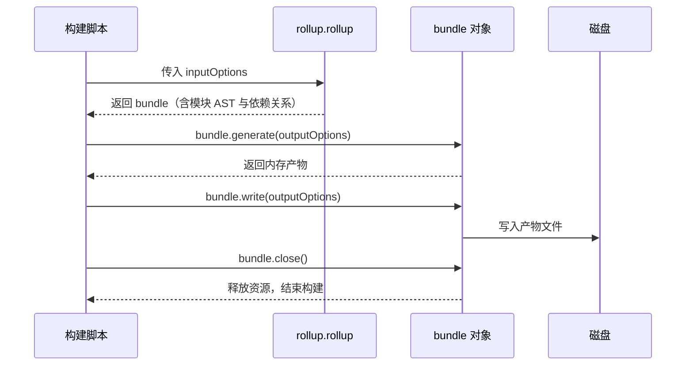

### 二、监听模式：rollup.watch

`watch` 模式会在源文件变动后自动重新打包，配置与 `rollup.config.js` 基本一致，仅多出 `watch` 字段：

```javascript [watch.js]
const rollup = require('rollup')

const watcher = rollup.watch({
  input: './src/index.js',
  output: [
    { dir: 'dist/es', format: 'esm' },
    { dir: 'dist/cjs', format: 'cjs' },
  ],
  watch: {
    exclude: ['node_modules/**'],
    include: ['src/**'],
  },
})

watcher.on('restart', () => {
  console.log('重新构建...')
})

watcher.on('change', (id) => {
  console.log('发生变动的模块 id: ', id)
})

watcher.on('event', (e) => {
  if (e.code === 'BUNDLE_END') {
    console.log('打包信息:', e)
  }
})
```

`BUNDLE_END` 事件中会携带 `duration`、`input`、`output` 以及 `result`（含 `cache`、`watchFiles`、`generate`、`write`、`close`）等完整构建信息。

## Rollup 整体构建阶段

执行 `rollup` 命令后，CLI 内部的主干逻辑可以简化为：

```typescript [cli 核心逻辑]
// Build 阶段
const bundle = await rollup.rollup(inputOptions)

// Output 阶段
await Promise.all(outputOptions.map(bundle.write))

// 构建结束
await bundle.close()
```

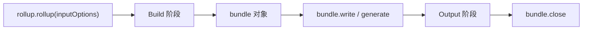

### 一、Build 阶段：只建图，不打包

Build 阶段负责创建模块依赖图、初始化各模块的 <word text="AST"/> 以及模块间依赖关系。此时得到的 `bundle` 对象并不包含打包产物，只存储模块内容与依赖关系，并挂载后续阶段要用的方法：

```json [bundle 对象结构]
{
  "cache": {
    "modules": [
      {
        "ast": "AST 节点信息",
        "code": "export const a = 1;",
        "dependencies": [],
        "id": "/Users/code/rollup-demo/src/data.js"
      },
      {
        "ast": "AST 节点信息",
        "code": "import { a } from './data';\n\nconsole.log(a);",
        "dependencies": ["/Users/code/rollup-demo/src/data.js"],
        "id": "/Users/code/rollup-demo/src/index.js"
      }
    ],
    "plugins": {}
  },
  "closed": false,
  "close": "[AsyncFunction: close]",
  "generate": "[AsyncFunction: generate]",
  "write": "[AsyncFunction: write]"
}
```

### 二、Output 阶段：真正的打包

真正生成产物的动作发生在 `bundle.generate` 或 `bundle.write` 中，两者的唯一区别是后者会把产物写入磁盘：

```typescript [调用 generate]
const bundle = await rollup.rollup({ input: ['./src/index.js'] })
const result = await bundle.generate({ format: 'es' })
console.log('result:', result)
```

```json [generate 返回结构]
{
  "output": [
    {
      "exports": [],
      "facadeModuleId": "/Users/code/rollup-demo/src/index.js",
      "isEntry": true,
      "isImplicitEntry": false,
      "type": "chunk",
      "code": "const a = 1;\n\nconsole.log(a);\n",
      "dynamicImports": [],
      "fileName": "index.js"
    }
  ]
}
```

> 结论：**一次完整构建 = 先 Build 阶段解析模块内容与依赖关系，再 Output 阶段完成打包与输出**。两大阶段对应两套完全不同的插件工作流。

## 插件 Hook 类型体系

### 一、按构建阶段划分

| 分类                       | 执行阶段    | 操作粒度                | 主要职责                             |
| -------------------------- | ----------- | ----------------------- | ------------------------------------ |
| <word text="Build Hook"/>  | Build 阶段  | 模块级（单文件）        | 模块代码转换、AST 解析、模块依赖解析 |
| <word text="Output Hook"/> | Output 阶段 | <word text="Chunk"/> 级 | 代码打包、产物内容修改、资源增删     |

### 二、按执行方式划分

| 类型         | 含义                                       | 底层实现      | 典型 <word text="Hook"/>                     |
| ------------ | ------------------------------------------ | ------------- | -------------------------------------------- |
| `Async`      | 异步钩子，内部可以包含异步逻辑             | `Promise`     | `resolveId`、`load`、`transform`             |
| `Sync`       | 同步钩子，内部不允许异步逻辑               | 直接调用      | 部分 `banner` / `intro` 类钩子               |
| `Parallel`   | 多插件并发执行，不等待彼此完成             | `Promise.all` | `buildStart`、`renderStart`                  |
| `Sequential` | 串行执行，前一个插件的返回值作为后一个入参 | 顺序 `await`  | `transform`、`renderChunk`、`generateBundle` |
| `First`      | 依次执行直到返回非 `null` / 非 `undefined` | 短路返回      | `resolveId`、`load`                          |

- `Async` / `Sync` 与 `Parallel` / `Sequential` / `First` 可以叠加，例如 `resolveId` 就是 `Async + First`（异步优先）。
- 需要「依赖其他插件处理结果」的场景必须使用 `Sequential`，否则会出现时序错乱。

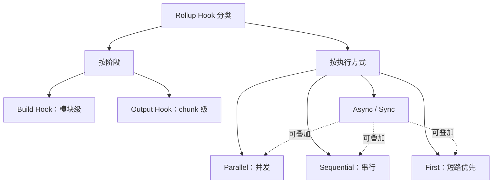

## Build 阶段工作流

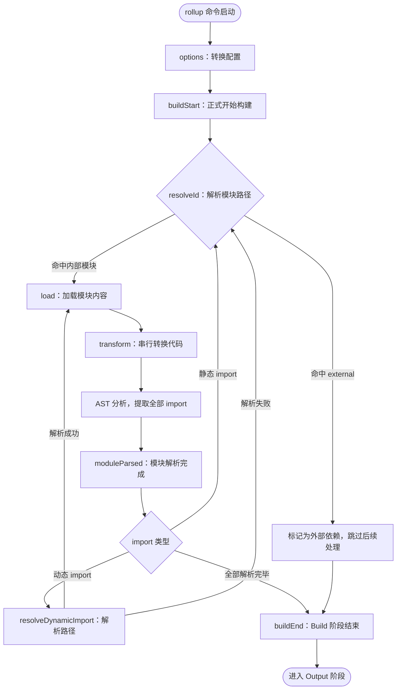

逐步拆解：

1. 先经历 `options` 钩子完成配置转换，得到处理后的配置对象。
2. 调用 `buildStart`，正式开启构建流程。
3. 从 `input` 指定的入口文件开始，进入 `resolveId` 解析文件路径。
4. 通过 `load` 加载模块内容。
5. 执行所有 `transform` 钩子，对模块内容做自定义转换（如 <word text="Babel"/> 转译）。
6. 对最终模块内容做 AST 分析，得到全部 import 语句，调用 `moduleParsed`：
   - 普通 import：再次执行 `resolveId`，回到步骤 3；
   - 动态 import：执行 `resolveDynamicImport`，成功则回到步骤 4，失败则回到步骤 3。
7. 全部 import 解析完毕后执行 `buildEnd`，Build 阶段结束。

若路径在 `resolveId` / `resolveDynamicImport` 中被标记为 <word text="External"/>，则跳过 `load`、`transform` 等后续处理。

### watch 模式的两个专属钩子

| <word text="Hook"/> | 触发时机                             |
| ------------------- | ------------------------------------ |
| `watchChange`       | 文件内容变化，watcher 触发并重新构建 |
| `closeWatcher`      | 当前打包过程结束时清除 watcher 对象  |

## Output 阶段工作流

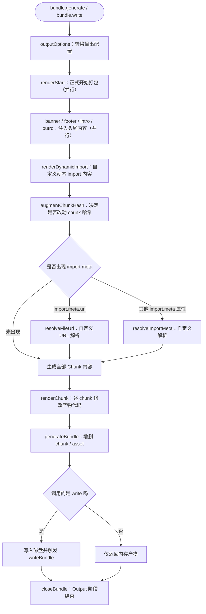

关键节点的语义：

1. `outputOptions`：对 `output` 配置做最终转换。
2. `renderStart`：并发执行，正式进入打包。
3. `banner` / `footer` / `intro` / `outro`：并发执行，往产物固定位置（头部 / 尾部）插入协议声明、项目介绍等自定义内容。
4. `renderDynamicImport`：从入口模块开始扫描，自定义动态 import 语句的生成内容。
5. `augmentChunkHash`：对每个即将生成的 <word text="Chunk"/> 决定是否变更哈希值，在 watch 模式（多次打包）下尤为实用。
6. `resolveFileUrl` / `resolveImportMeta`：分别处理 `import.meta.url` 与其他 `import.meta` 属性。
7. `renderChunk`：逐 chunk 调用，此处可以直接操作打包产物代码。
8. `generateBundle`：入参包含全部产物信息（`chunk` 与 `asset`），可在此删除不需要的产物，被删除的内容不会输出。
9. `writeBundle`：仅 `bundle.write` 会触发，执行时产物已落盘。
10. `closeBundle`：`bundle.close` 被调用时触发，Output 阶段正式结束。

### generateBundle 与 writeBundle 的时序差异

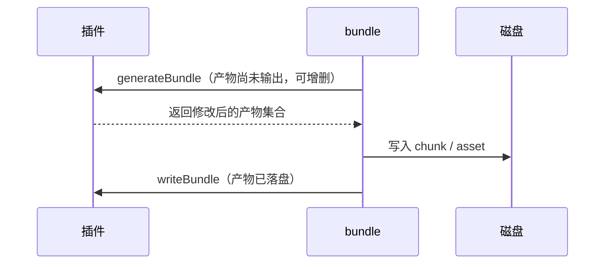

> 若打包过程中任一阶段出现错误，会先触发 `renderError`，随后执行 `closeBundle` 结束打包。

### 两大阶段 Hook 数量分布

按官方文档公开的 <word text="Hook"/> 计算，Output 阶段的钩子明显多于 Build 阶段：

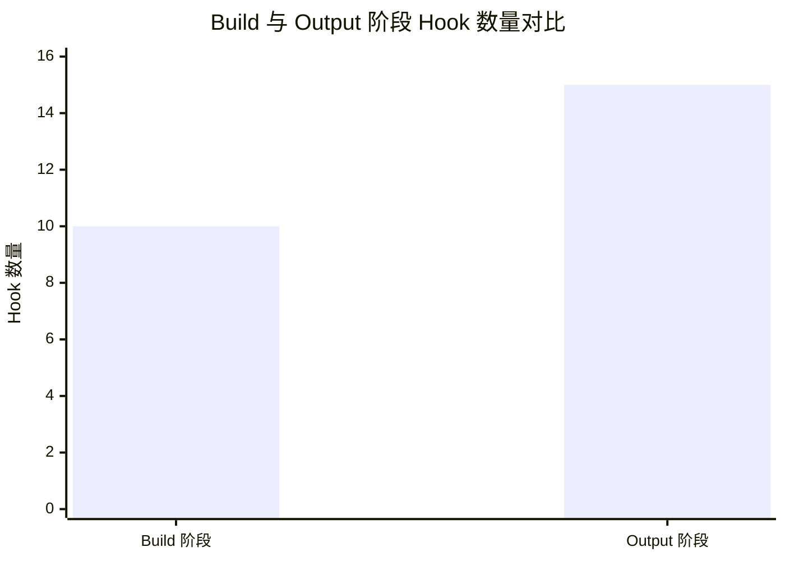

### 一次构建中各核心 Hook 的调用频次

以「入口 + 2 个静态依赖」共 3 个模块、最终合并为 1 个 chunk 的项目为例，各核心 <word text="Hook"/> 的调用次数如下：

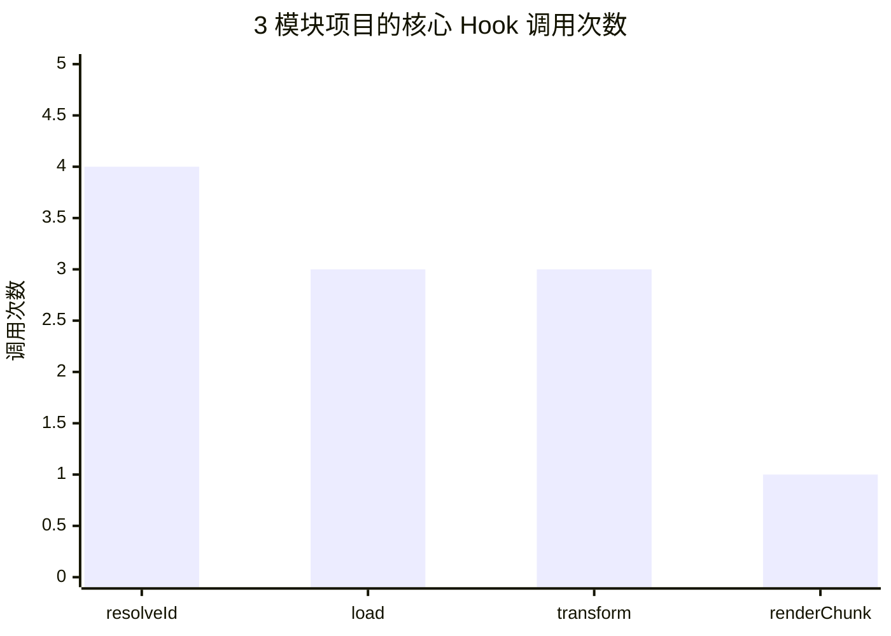

`resolveId` 的调用次数高于模块数，是因为入口文件本身也要经过一次路径解析（3 次模块解析 + 1 次入口解析）；而 `renderChunk` 的粒度是 chunk，多个模块合并为同一个 chunk 时只会调用一次。

## 常用 Hook 实战

开发 <word text="Rollup 插件"/> 的本质，就是编写一个个 <word text="Hook"/> 函数——一个插件基本就是多种 <word text="Hook"/> 的组合。遵循二八定律：20% 的 API 覆盖 80% 的场景。

### 一、路径解析：resolveId

`resolveId` 为 `Async + First` 类型，用于解析模块路径。以官方 `alias` 插件为例：

```javascript [rollup.config.js]
import alias from '@rollup/plugin-alias'

export default {
  input: 'src/index.js',
  output: { dir: 'output', format: 'cjs' },
  plugins: [
    alias({
      entries: [
        // 将 import xxx from 'module-a' 转换为 './module-a.js'
        { find: 'module-a', replacement: './module-a.js' },
      ],
    }),
  ],
}
```

插件核心实现（简化）：

```javascript [alias 插件]
export default function alias(options) {
  const entries = getEntries(options)
  return {
    // 入参：当前模块路径、引用当前模块的模块路径、其余解析参数
    resolveId(importee, importer, resolveOptions) {
      const matchedEntry = entries.find((entry) =>
        matches(entry.find, importee),
      )
      // 无法匹配别名，或当前是入口模块，则不处理
      if (!matchedEntry || !importerId) {
        // 返回 null，路径交给下一个插件处理
        return null
      }
      const updatedId = normalizeId(
        importee.replace(matchedEntry.find, matchedEntry.replacement),
      )
      // this.resolve 会执行除当前插件外所有插件的 resolveId
      return this.resolve(
        updatedId,
        importer,
        Object.assign({ skipSelf: true }, resolveOptions),
      ).then((resolved) => {
        let finalResult = resolved
        if (!finalResult) {
          finalResult = { id: updatedId }
        }
        return finalResult
      })
    },
  }
}
```

| 返回值   | 行为                                                            |
| -------- | --------------------------------------------------------------- |
| `null`   | 交给下一个插件的 `resolveId` 继续处理                           |
| `string` | 立即终止后续插件处理，直接作为解析结果                          |
| 对象     | 终止后续处理，可携带 `id`、`external`、`treeshake` 等更丰富信息 |

### 二、加载模块内容：load

`load` 同样是 `Async + First` 类型，按 `resolveId` 解析出的路径加载模块内容。以官方 `image` 插件为例：

```javascript [image 插件]
const mimeTypes = {
  '.jpg': 'image/jpeg',
  // 其余图片类型省略
}

export default function image(opts = {}) {
  const options = Object.assign({}, defaults, opts)
  return {
    name: 'image',
    load(id) {
      const mime = mimeTypes[extname(id)]
      if (!mime) {
        // 非图片类型，返回 null 交给下一个插件
        return null
      }
      const isSvg = mime === mimeTypes['.svg']
      const format = isSvg ? 'utf-8' : 'base64'
      const source = readFileSync(id, format).replace(/[\r\n]+/gm, '')
      const dataUri = getDataUri({ format, isSvg, mime, source })
      const code = options.dom
        ? domTemplate({ dataUri })
        : constTemplate({ dataUri })

      return code.trim()
    },
  }
}
```

| 返回值          | 行为                                                          |
| --------------- | ------------------------------------------------------------- |
| `null`          | 交给下一个插件处理                                            |
| `string` / 对象 | 终止后续处理；对象可携带 <word text="SourceMap"/>、AST 等细节 |

### 三、代码转换：transform

`transform` 为 `Async + Sequential` 类型（异步串行），对加载后的模块内容做自定义转换。以官方 `replace` 插件为例：

```javascript [rollup.config.js]
import replace from '@rollup/plugin-replace'

export default {
  input: 'src/index.js',
  output: { dir: 'output', format: 'cjs' },
  plugins: [
    // 把代码中所有 __TEST__ 替换为 1
    replace({ __TEST__: 1 }),
  ],
}
```

核心实现基于 <word text="MagicString"/> 做字符串替换并生成映射：

```javascript [replace 插件]
import MagicString from 'magic-string'

export default function replace(options = {}) {
  return {
    name: 'replace',
    transform(code, id) {
      return executeReplacement(code, id)
    },
  }
}

function executeReplacement(code, id) {
  const magicString = new MagicString(code)
  if (!codeHasReplacements(code, id, magicString)) {
    return null
  }

  const result = { code: magicString.toString() }

  if (isSourceMapEnabled()) {
    result.map = magicString.generateMap({ hires: true })
  }

  // 返回包含 code 与 map 的对象
  return result
}
```

| 入参         | 返回值                    | 关键约束                                                        |
| ------------ | ------------------------- | --------------------------------------------------------------- |
| `code`、`id` | `{ code, map }` 或 `null` | 当前插件返回的 `code` 会作为下一个插件 `transform` 的第一个入参 |

这种「瀑布流」式传递意味着：越靠后的插件，看到的是越靠前插件处理后的代码。

### 四、Chunk 级修改：renderChunk

`replace` 插件同样实现了 `renderChunk`：

```javascript [replace 插件]
export default function replace(options = {}) {
  return {
    name: 'replace',
    transform(code, id) {
      // transform 逻辑省略
    },
    renderChunk(code, chunk) {
      const id = chunk.fileName
      // 拿到 chunk 的代码与文件名，执行替换
      return executeReplacement(code, id)
    },
  }
}
```

之所以在 `transform` 之后还要再做一次替换，是因为后续插件的 `transform` 仍可能产生符合替换规则的字符串——在 <word text="Chunk"/> 级别兜底，替换结果才足够准确。

| 入参            | 返回值                    | 说明                                     |
| --------------- | ------------------------- | ---------------------------------------- |
| `code`、`chunk` | `{ code, map }` 或 `null` | `chunk` 为产物元信息，可直接改写产物代码 |

### 五、产物生成最后一步：generateBundle

`generateBundle` 为异步串行钩子，可在此删除无用 <word text="Chunk"/> / 静态资源，或自行添加文件。以官方 `html` 插件为例：

```javascript [html 插件]
export default function html(opts = {}) {
  return {
    name: 'html',
    async generateBundle(output, bundle) {
      // 1. 获取打包后的文件
      const files = getFiles(bundle)
      // 2. 组装 HTML，插入 meta、link 与 script 标签
      const source = await template({
        attributes,
        bundle,
        files,
        meta,
        publicPath,
        title,
      })
      // 3. 通过上下文的 emitFile 输出 HTML 文件
      this.emitFile({
        type: 'asset',
        source,
        name: 'Rollup HTML Asset',
        fileName,
      })
    },
  }
}
```

| 入参               | 能力                                                              |
| ------------------ | ----------------------------------------------------------------- |
| `output`、`bundle` | 删除不需要的 chunk / asset，或通过 `this.emitFile` 输出自定义文件 |

### 六、五个高频 Hook 速查报表

| <word text="Hook"/> | 阶段   | 执行类型             | 操作粒度 | 典型用途                               |
| ------------------- | ------ | -------------------- | -------- | -------------------------------------- |
| `resolveId`         | Build  | `Async + First`      | 模块     | 路径别名、外部化判定、虚拟模块         |
| `load`              | Build  | `Async + First`      | 模块     | 加载非标准资源（图片、JSON、远程内容） |
| `transform`         | Build  | `Async + Sequential` | 模块     | 语法转译、代码替换、注入环境变量       |
| `renderChunk`       | Output | 异步串行             | Chunk    | 产物级代码修改、兜底替换               |
| `generateBundle`    | Output | 异步串行             | 产物集合 | 增删产物文件、生成 HTML / 分析报告     |

## 插件机制的设计优势

| 设计维度         | 具体表现                                                                                                                                                               |
| ---------------- | ---------------------------------------------------------------------------------------------------------------------------------------------------------------------- |
| **逻辑集中管理** | 各阶段 <word text="Hook"/> 可写在同一插件中，<word text="Webpack"/> 里需要 Loader + Plugin 两套机制的能力，在 <word text="Rollup"/> 中只需 `transform` + `renderChunk` |
| **API 简洁直观** | 插件本质是返回一个含 `name` 与若干 <word text="Hook"/> 函数的对象，学习成本低                                                                                          |
| **插件互相调用** | 通过 <word text="Plugin Context"/> 的 `this.resolve` / `this.load` 触发其他插件的对应钩子，灵活性极高                                                                  |
| **非侵入式扩展** | 核心打包逻辑与插件逻辑分离，避免核心代码臃肿，提升可维护性                                                                                                             |

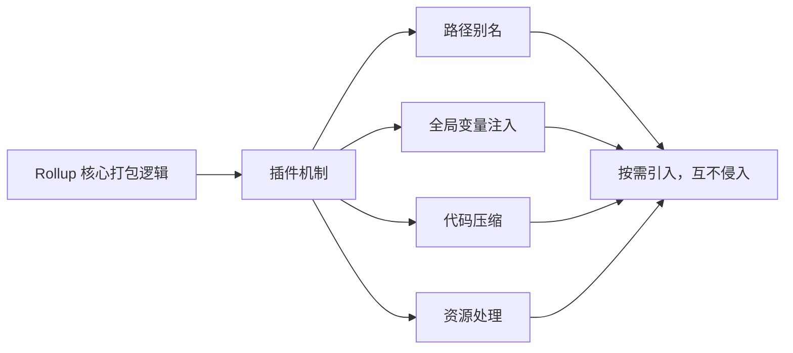

## 小结与进阶指引

本文从「怎么用」走到「怎么扩展」，完整覆盖了 <word text="Rollup"/> 的两条主线：

1. **基础配置**：`input`（字符串 / 数组 / 对象）、`output`（多产物数组、文件名占位符、`format`）、`external`（外部化）、`plugins`（顶层与 `output` 内两种位置），配合 `resolve` + `commonjs` 解决 <word text="CommonJS"/> 依赖打包问题。
2. **编程式调用**：`rollup.rollup` 三步走（生成 bundle → `generate` / `write` → `close`）；`rollup.watch` 通过 `restart` / `change` / `event` 事件驱动增量构建。
3. **构建生命周期**：Build 阶段建依赖图、解析 AST，Output 阶段才真正打包；`bundle` 对象在两阶段之间充当载体。
4. **Hook 类型体系**：`Async` / `Sync` 描述同步性，`Parallel` / `Sequential` / `First` 描述协作方式，二者可叠加。
5. **工作流顺序**：Build 阶段围绕 `resolveId → load → transform → moduleParsed` 递归展开；Output 阶段从 `outputOptions` 一路走到 `closeBundle`，其中 `generateBundle` 与 `writeBundle` 的差别在于产物是否已落盘。
6. **五大高频 Hook**：`resolveId` 与 `load` 是「异步优先」，`transform` / `renderChunk` / `generateBundle` 是「异步串行」；`transform` 面向模块、后两者面向 <word text="Chunk"/> 与产物集合。

**进阶方向：**

- 对照 <word text="Vite"/> 源码中的 <word text="Plugin Container"/> 实现，观察它如何在开发阶段模拟 <word text="Rollup"/> 的 <word text="Hook"/> 调度，并额外注入 `configureServer`、`transformIndexHtml` 等 Vite 专属钩子；
- 尝试编写一个「虚拟模块 + 产物分析」插件，组合 `resolveId`（返回虚拟 id）、`load`（返回内存内容）与 `generateBundle`（输出统计报告），体会插件间协作的完整闭环；
- 结合 `augmentChunkHash` 与 `renderChunk`，在 watch 模式下实现稳定的产物哈希与增量更新策略。
