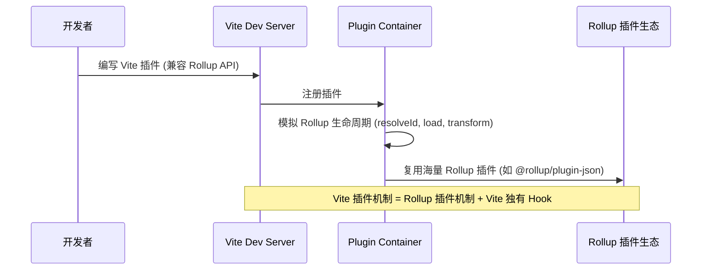

# 双引擎架构：Vite 是如何站在巨人的肩膀上实现的？

## 核心主旨
Vite 的高性能并非凭空而来，而是深度依赖于底层的两个构建引擎——**Esbuild** 和 **Rollup**。很多人对 Vite 的认知仅停留在“开发用 Esbuild，生产用 Rollup”，但实际上 Vite 的架构远不止于此。
本文将系统拆解 Vite 的双引擎架构，深入剖析 Esbuild 作为“性能利器”在预构建、编译、压缩三大垂直领域的极致应用，以及 Rollup 作为“构建基石”在生产环境打包与插件生态中的核心地位，帮助你建立对 Vite 底层架构的全局认知。


## Vite 双引擎架构全景图

为了更直观地理解双引擎的协作机制，我们可以通过以下架构图来俯瞰 Vite 的核心流转过程：

```mermaid
graph TD
    subgraph Vite 双引擎核心架构
        direction TB
        
        subgraph 开发环境 (Dev Server)
            A[源码 / node_modules] --> B{Esbuild}
            B -->|Bundler| C[依赖预构建: CJS -> ESM]
            B -->|Transformer| D[单文件编译: TS/JSX 转译]
            
            E[Vite Plugin Pipeline] --> F[Plugin Container]
            F -->|模拟 Rollup 调度| G[Rollup 插件生态]
        end

        subgraph 生产环境 (Build)
            H[源码 / 预构建依赖] --> I[Rollup Bundle]
            I -->|CSS 分割 / 预加载优化| J[产物 Chunk]
            J --> K{Esbuild}
            K -->|Minifier| L[JS/CSS 极速压缩]
        end
    end
    
    C -.->|缓存至 .vite/deps| A
    D -.->|内存实时编译| M[浏览器 ESM 加载]
    L --> N[最终静态资源 dist/]
```


## 性能利器——Esbuild

Esbuild 是 Vite 实现“秒级启动”和“极致开发体验”的得力助手。Vite 将 Esbuild 在三个关键的垂直方向（`Bundler`、`Transformer`、`Minifier`）利用到了极致。

### 一、 依赖预构建（作为 Bundler）
在开发阶段，`node_modules` 中的依赖动辄几百 MB，且多为 CommonJS 格式。Vite 在 2.x 版本果断弃用 Rollup，改用 Esbuild 进行依赖预构建，解决了 **ESM 格式兼容性** 和 **海量 HTTP 请求** 两大痛点。

### 二、 单文件编译（作为 Transformer）
Vite 通过插件将 Esbuild 的转译能力应用于 TS(X)/JS(X) 的单文件编译，彻底替代了传统缓慢的 Babel 和 TSC。

**编译性能对比（以 50MB 纯代码文件为例）：**
| 编译工具 | 语言底层 | 性能表现 | 适用场景 |
| --- | --- | --- | --- |
| **Esbuild** | Go | **极快（毫秒/秒级）** | Vite 默认单文件编译 |
| SWC | Rust | 极快 | 备选高性能方案 |
| Babel | JS | 慢 | 需要复杂 AST 自定义转换 |
| TSC | JS | 极慢 | 仅用于类型检查 |

### 三、 代码压缩（作为 Minifier）
从 Vite 2.6 开始，默认使用 Esbuild 替代 Terser 进行生产环境的代码压缩。

**📊 实际大型库（Echarts 3.2MB）压缩性能测试：**
| 压缩工具 | 耗时 | 性能提升 | 核心优势 |
| --- | --- | --- | --- |
| **Esbuild** | **361 ms** | **基准（快 20~30 倍）** | 原生 Go 语言、全程共享 AST |
| Terser | 8798 ms | 慢 | 传统 JS 编写、重复解析 AST |

### Esbuild 的局限性
尽管性能恐怖，但 Esbuild 仍有其边界，Vite 在设计时也做出了相应的妥协与互补：
| 局限性 | 影响 | Vite 的应对策略 |
| --- | --- | --- |
| **不支持降级到 ES5** | 低端浏览器无法运行 | 生产环境依赖 Rollup 生态或 Polyfill 插件兜底 |
| **不支持 `const enum`** | 特定 TS 语法直接抛错 | 推荐避免使用，或改用 SWC/Babel 插件 |
| **无产物操作接口** | 缺乏类似 `renderChunk` 的钩子 | 生产环境复杂产物处理交由 Rollup 插件完成 |
| **不支持自定义拆包策略** | 降级了 Code Splitting 灵活性 | 生产环境完全依赖 Rollup 的拆包能力 |
| **无 TS 类型检查** | 仅抹除类型，不报错 | 构建脚本前置 `tsc --noEmit` 进行独立类型检查 |


## 构建基石——Rollup

如果说 Esbuild 决定了 Vite 的**下限（开发体验）**，那么 Rollup 则决定了 Vite 的**上限（生产质量与生态）**。

### 一、 生产环境 Bundle 优化
虽然 ESM 普及，但生产环境完全 `no-bundle` 会导致严重的网络性能问题。Vite 基于 Rollup 成熟的打包能力，进行了三大核心扩展优化：

1. **CSS 代码分割**：异步模块引入的 CSS 会被自动抽取为独立文件，提升线上缓存复用率。
2. **自动预加载（Modulepreload）**：自动为入口 chunk 的依赖生成预加载标签，让浏览器提前下载资源。
   ```html
   <head>
     <!-- 入口 chunk -->
     <script type="module" crossorigin src="/assets/index.250e0340.js"></script>
     <!-- Vite 自动生成的预加载标签 -->
     <link rel="modulepreload" href="/assets/vendor.293dca09.js">
   </head>
   ```
3. **异步 Chunk 加载优化**：智能识别异步 Chunk 的公共依赖。例如 A 和 B 都依赖 C，在请求 A 的同时，Vite 会自动预加载 C，省去浏览器解析 A 后再请求 C 的网络等待时间。

### 二、 兼容插件机制（Plugin Container）
Vite 能够迅速占领市场，很大程度上得益于其**根植于 Rollup 生态**的明智之举。



* **生态降维打击**：相比于 Snowpack 自研插件机制导致的生态孤岛，Vite 直接兼容 Rollup 积累了 6 年、年下载量上亿的插件生态。
* **双向兼容性**：Vite 插件可以直接用于 Rollup（生产环境）；但 Rollup 插件不一定完全兼容 Vite（因为 Vite 增加了如 `configureServer`、`transformIndexHtml` 等专属 Web 场景的 Hook）。


## 双引擎协作矩阵总结

为了更清晰地理解两者在 Vite 中的定位，我们可以通过以下矩阵进行对比：

| 对比维度 | Esbuild (性能利器) | Rollup (构建基石) |
| --- | --- | --- |
| **核心定位** | 极致的编译与转换引擎 | 工业级的模块打包与生态枢纽 |
| **开发阶段** | 依赖预构建、TS/JSX 单文件转译 | 提供插件规范，通过 Plugin Container 调度 |
| **生产阶段** | JS/CSS 代码极速压缩 (Minifier) | 核心 Bundle 打包、CSS 分割、预加载优化 |
| **底层语言** | Go (并发强、AST 共享) | JavaScript (生态繁荣、Hook 灵活) |
| **优势** | 速度极快（快 10~100 倍） | 产物优化能力强、插件生态极其丰富 |
| **劣势** | 缺乏高级产物控制、无类型检查 | 原生 JS 编写，冷启动与打包速度较慢 |


## 小结与进阶指引

Vite 的成功，本质上是 **“场景化深度扩展”** 的胜利。它将 Rollup 从传统的 JS 库打包场景，扩展至完整的 Web 应用打包，并结合开发阶段 `no-bundle` 的核心竞争力，打造了独具一格的技术品牌。

**核心收获：**
1. **Esbuild 负责“快”**：包揽预构建、单文件编译、代码压缩，用 Go 语言的底层优势碾压传统 JS 工具链。
2. **Rollup 负责“稳”与“广”**：兜底生产环境的产物质量（拆包、预加载），并承载了整个前端构建工具的插件生态。
3. **架构哲学**：不重复造轮子，站在巨人的肩膀上，将合适的工具放在合适的构建阶段。

**进阶指引：**
理解了双引擎架构后，接下来的学习应聚焦于：
* 深入 **Rollup 插件开发**，掌握 Vite 插件的底层 Hook 机制。
* 探究 **Esbuild 的 API 边界**，学习如何通过自定义 Esbuild 插件解决特殊的依赖兼容问题。
* 阅读 Vite 源码中的 **Plugin Container** 实现，理解它是如何巧妙模拟 Rollup 生命周期的。