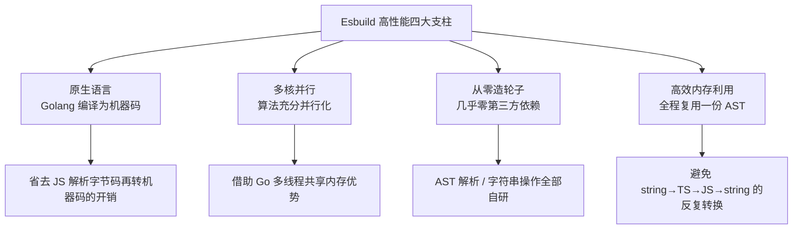
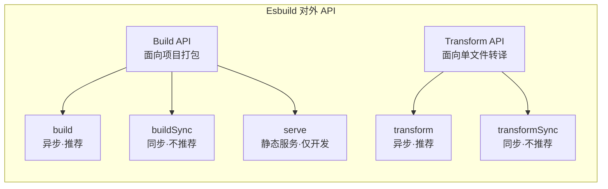
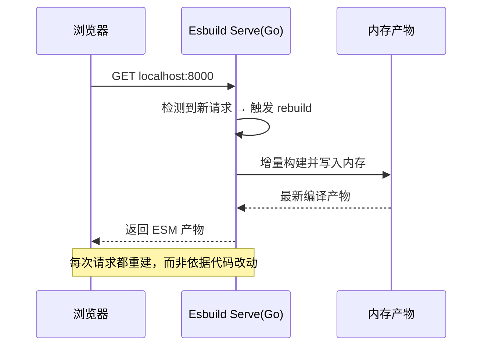
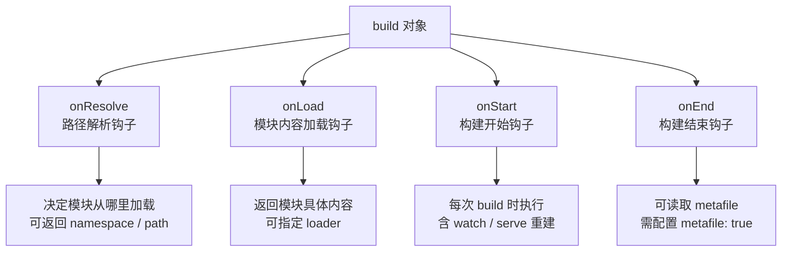
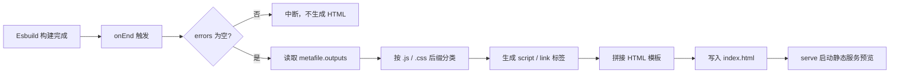
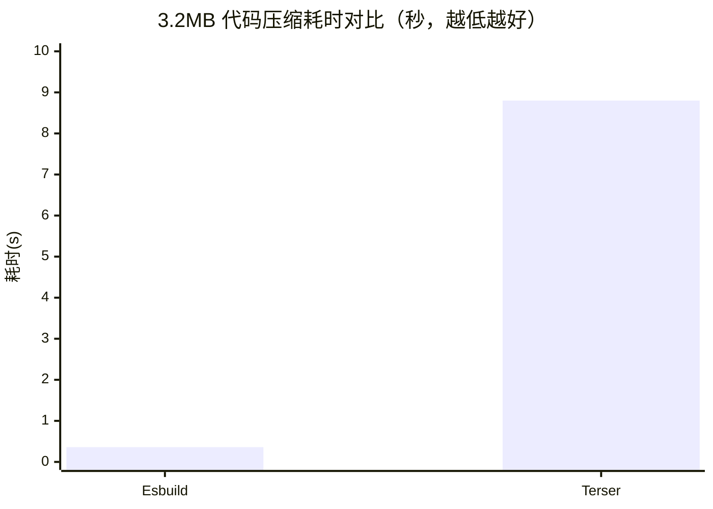

# 得力的性能推手：Esbuild 功能使用与插件开发实战

## 核心主旨

<word text="Esbuild"/> 是 <word text="Vite"/> 双引擎架构中负责"快"的那一半，在依赖预编译、<word text="TSX"/> 语法转译、代码压缩等关键构建阶段让 <word text="Vite"/> 获得了远超传统工具链的性能表现。无论是 <word text="Vite"/> 的配置项还是源码实现，都大量复用了 <word text="Esbuild"/> 自身的基本概念与高阶用法。

本文聚焦 <word text="Esbuild"/> 本体：先剖析其性能为何能比传统打包工具快 10~100 倍，再系统讲解 **命令行调用** 与 **代码调用** 两种使用方式（<word text="Build API"/> / <word text="Transform API"/>），最后通过一个 `env` 插件入门与两个完整实战（CDN 依赖拉取插件、HTML 构建插件），彻底掌握 <word text="Esbuild"/> 的插件开发范式与关键钩子。

## 为什么 Esbuild 性能极高

<word text="Esbuild"/> 由 Figma 的 CTO「Evan Wallace」基于 <word text="Golang"/> 开发，主打性能优势。其超高构建性能可以归纳为 4 个原因：



| 性能支柱         | 具体做法                                               | 带来的收益                                               |
| ---------------- | ------------------------------------------------------ | -------------------------------------------------------- |
| **Golang 开发**  | 构建逻辑代码直接编译为原生机器码                       | 无需"源码 → 字节码 → 机器码"的多段转换，大幅节省运行时间 |
| **多核并行**     | 内部打包算法尽可能让所有步骤并行                       | 充分利用多核 CPU，得益于 Go 多线程共享内存               |
| **从零造轮子**   | 大至 <word text="AST"/> 解析，小到字符串操作，全部自研 | 摆脱第三方库的性能损耗，保证极致代码性能                 |
| **高效内存利用** | 从头到尾尽可能复用同一份 AST 节点数据                  | 避免 JS 打包工具中频繁解析与传递 AST 造成的内存浪费      |

## Esbuild 功能使用

使用 <word text="Esbuild"/> 有 2 种方式：**命令行调用** 与 **代码调用**。安装只需一条命令：

```bash
pnpm init -y
pnpm i esbuild
```

### 一、命令行调用

命令行是最简单的使用方式，适合快速验证与简单场景。准备一个 <word text="JSX"/> 示例：

::: code-group

```tsx [src/index.jsx]
import Server from 'react-dom/server'

let Greet = () => <h1>Hello, juejin!</h1>
console.log(Server.renderToString(<Greet />))
```

```json [package.json]
{
  "scripts": {
    "build": "./node_modules/.bin/esbuild src/index.jsx --bundle --outfile=dist/out.js"
  }
}
```

:::

执行 `pnpm run build` 即可完成打包。但命令行只能传入简单参数，稍微复杂的场景（自定义插件、精细 loader 配置）就不适用了，因此工程中更常用代码调用。

### 二、代码调用

<word text="Esbuild"/> 对外暴露的 API 分为两类：<word text="Build API"/> 与 <word text="Transform API"/>，可在 <word text="Node.js"/> 代码中按需调用。



## Build API：项目打包

`build` 是异步方法，返回一个 Promise。下面是一份覆盖常见配置项的示例：

```javascript [build.js]
const { build, buildSync, serve } = require('esbuild')

async function runBuild() {
  const result = await build({
    absWorkingDir: process.cwd(),
    entryPoints: ['./src/index.jsx'],
    outdir: 'dist',
    bundle: true,
    format: 'esm',
    external: [],
    splitting: true,
    sourcemap: true,
    metafile: true,
    minify: false,
    watch: false,
    write: true,
    loader: {
      '.png': 'base64',
    },
  })
  console.log(result)
}

runBuild()
```

执行 `node build.js` 后，控制台会打印打包元信息，`dist` 目录中也会写入产物与 <word text="SourceMap"/> 文件。

### 常用配置项速查

| 配置项          | 类型                            | 作用说明                                   |
| --------------- | ------------------------------- | ------------------------------------------ |
| `absWorkingDir` | `string`                        | 当前项目根目录，所有相对路径以此为基准     |
| `entryPoints`   | `string[]`                      | 入口文件列表，支持多入口                   |
| `outdir`        | `string`                        | 打包产物输出目录                           |
| `bundle`        | `boolean`                       | 是否进行依赖打包，一般设为 `true`          |
| `format`        | `'esm' \| 'commonjs' \| 'iife'` | 产物模块格式                               |
| `external`      | `string[]`                      | 排除打包的依赖列表                         |
| `splitting`     | `boolean`                       | 是否开启自动拆包（需配合 `format: 'esm'`） |
| `sourcemap`     | `boolean`                       | 是否生成 SourceMap 文件                    |
| `metafile`      | `boolean`                       | 是否生成打包元信息，插件开发必备           |
| `minify`        | `boolean`                       | 是否压缩代码                               |
| `watch`         | `boolean`                       | 监听模式下代码变动触发重新打包             |
| `write`         | `boolean`                       | 是否将产物写入磁盘                         |
| `loader`        | `Record<string, Loader>`        | 特殊后缀文件的加载器映射                   |

<word text="Esbuild"/> 内置一系列 <word text="Loader"/>：`base64`、`binary`、`css`、`dataurl`、`file`、`js(x)`、`ts(x)`、`text`、`json`，针对不同文件类型调用不同加载器。

### 为什么不推荐 buildSync

`buildSync` 用法与 `build` 几乎相同，只是同步调用，但会带来两方面不良后果：

- 容易使 <word text="Esbuild"/> 在当前线程阻塞，丧失**并发任务处理**的优势；
- 所有插件中都不能使用任何异步操作，给**插件开发**增加限制。

### serve：内置静态服务

`serve` 是 <word text="Build API"/> 中能力较强的一个方法，有 3 个特点：

1. 在指定端口与目录上搭建**静态文件服务**，服务器用原生 Go 实现，性能比 <word text="Node.js"/> 更高；
2. 类似 webpack-dev-server，产物默认不写磁盘，而是放在内存中通过请求访问；
3. **每次请求**到来时都会重新构建（rebuild），永远返回最新产物。

> 注意：触发 rebuild 的条件并不是代码改动，而是**新的请求到来**。每次 rebuild 都是增量构建，耗时通常比首次构建减少约 70%。

```javascript [build.js]
const { serve } = require('esbuild')

serve(
  {
    port: 8000,
    servedir: './dist',
  },
  {
    absWorkingDir: process.cwd(),
    entryPoints: ['./src/index.jsx'],
    bundle: true,
    format: 'esm',
    splitting: true,
    sourcemap: true,
    metafile: true,
  },
).then((server) => {
  console.log('HTTP Server starts at port', server.port)
})
```



> Serve API 只适合开发阶段，不适用于生产环境。

## Transform API：单文件转译

除项目打包外，<word text="Esbuild"/> 还专门提供了单文件编译能力，即 <word text="Transform API"/>，同样包含异步的 `transform` 与同步的 `transformSync`：

```javascript [transform.js]
const { transform, transformSync } = require('esbuild')

async function runTransform() {
  // 第一个参数是代码字符串，第二个参数为编译配置
  const content = await transform(
    'const isNull = (str: string): boolean => str.length > 0;',
    {
      sourcemap: true,
      loader: 'tsx',
    },
  )
  console.log(content)
}

runTransform()
```

与 <word text="Build API"/> 结论一致，同步的 `transformSync` 会丧失并发优势，**不推荐使用**。出于性能考虑，<word text="Vite"/> 底层正是采用异步的 `transform` 完成 TS 与 <word text="JSX"/> 的单文件转译。

## Esbuild 插件开发

插件开发本质是在原有体系结构上进行**扩展**与**自定义**：通过插件可以扩展路径解析、模块加载等能力，并在构建过程中执行一系列自定义逻辑。<word text="Vite"/> 依赖预编译的实现中，就大量应用了 <word text="Esbuild"/> 插件的逻辑。

### 基本概念：插件结构

插件被设计为一个对象，包含 `name` 与 `setup` 两个属性：`name` 是插件名称，`setup` 是函数，入参为一个 `build` 对象，该对象上挂载了若干钩子供自定义。

```javascript [env-plugin.js]
const envPlugin = {
  name: 'env',
  setup(build) {
    // 1. 拦截 env 模块的路径解析，打上 namespace 标记
    build.onResolve({ filter: /^env$/ }, (args) => ({
      path: args.path,
      namespace: 'env-ns',
    }))

    // 2. 在 onLoad 中按 namespace 过滤，返回模块内容
    build.onLoad({ filter: /.*/, namespace: 'env-ns' }, () => ({
      contents: JSON.stringify(process.env),
      loader: 'json',
    }))
  },
}

require('esbuild')
  .build({
    entryPoints: ['src/index.jsx'],
    bundle: true,
    outfile: 'out.js',
    plugins: [envPlugin],
  })
  .catch(() => process.exit(1))
```

应用插件后，`import { PATH } from 'env'` 会在构建时被替换为 `process.env` 对象。

### 钩子总览



| 钩子        | 触发时机                                 | 典型用途                                                |
| ----------- | ---------------------------------------- | ------------------------------------------------------- |
| `onResolve` | 解析模块路径时                           | 拦截特殊路径（如 URL、虚拟模块），返回 `namespace` 标记 |
| `onLoad`    | 加载模块内容时                           | 按 `namespace` 过滤，返回 `contents` 与 `loader`        |
| `onStart`   | 每次 build 开始时（含 watch/serve 重建） | 打印日志、清理产物、准备环境                            |
| `onEnd`     | 每次 build 结束时                        | 读取 `metafile`，生成 HTML、上报构建信息                |

### onResolve 与 onLoad 的参数

两个钩子都需要传入 `Options` 与 `Callback` 两个参数。

```typescript
interface Options {
  filter: RegExp
  namespace?: string
}
```

`filter` 为必传的正则表达式，决定要过滤出的特征文件；`namespace` 为选填，一般在 `onResolve` 回调中返回作为标识，再在 `onLoad` 中用它把模块过滤出来。

> 注意：插件中的 `filter` 正则使用 Go 原生正则实现。为了不使性能劣化，规则应尽可能严格；同时它与 JS 正则有所区别，**不支持前瞻 `(?<=)`、后顾 `(?=)` 和反向引用 `\1`**。

**onResolve 回调的入参与返回值（节选）：**

| 方向        | 字段                       | 说明                                        |
| ----------- | -------------------------- | ------------------------------------------- |
| 入参 `args` | `path`                     | 模块路径                                    |
| 入参 `args` | `importer`                 | 父模块路径                                  |
| 入参 `args` | `namespace`                | 命名空间标识                                |
| 入参 `args` | `resolveDir`               | 基准路径                                    |
| 入参 `args` | `kind`                     | 导入方式，如 `import`、`require`            |
| 返回        | `path`                     | 重写后的模块路径                            |
| 返回        | `namespace`                | 命名空间标识                                |
| 返回        | `external`                 | 是否需要 external                           |
| 返回        | `sideEffects`              | 设为 `false` 且模块未被用到时，代码会被删除 |
| 返回        | `suffix`                   | 追加路径后缀，如 `?xxx`                     |
| 返回        | `watchFiles` / `watchDirs` | 仅 watch 模式生效，额外监听的文件/目录      |

**onLoad 回调的入参与返回值（节选）：**

| 方向        | 字段                            | 说明                                      |
| ----------- | ------------------------------- | ----------------------------------------- |
| 入参 `args` | `path` / `namespace` / `suffix` | 模块路径、命名空间、后缀信息              |
| 返回        | `contents`                      | 模块具体内容                              |
| 返回        | `loader`                        | 指定 loader，如 `js`、`ts`、`tsx`、`json` |
| 返回        | `resolveDir`                    | 基准路径                                  |
| 返回        | `pluginData`                    | 额外绑定的插件数据                        |

### onStart 与 onEnd

```javascript
const examplePlugin = {
  name: 'example',
  setup(build) {
    build.onStart(() => {
      console.log('build started')
    })
    build.onEnd((buildResult) => {
      if (buildResult.errors.length) return
      // 构建元信息：拿到后可做自定义事情，比如生成 HTML
      console.log(buildResult.metafile)
    })
  },
}
```

使用时有 2 点需要注意：

1. `onStart` 的执行时机是**每次 build**，包括 `watch` 或 `serve` 模式下的重新构建；
2. `onEnd` 中若想拿到 `metafile`，必须在构建配置中把 `metafile` 设为 `true`。

## 实战 1：CDN 依赖拉取插件

<word text="Esbuild"/> 原生不支持通过 <word text="HTTP"/> 从 <word text="CDN"/> 服务拉取第三方依赖。例如下面的代码直接 `import` URL 是无法运行的：

```javascript
// src/index.jsx
import { render } from 'https://cdn.skypack.dev/react-dom'
import React from 'https://cdn.skypack.dev/react'

let Greet = () => <h1>Hello, juejin!</h1>
render(<Greet />, document.getElementById('root'))
```

这里用到了 <word text="Skypack"/>——一个提供 <word text="NPM"/> 包 <word text="ESM"/> 产物的 <word text="CDN"/> 服务。借助插件识别此类 URL 并联网获取模块内容，甚至可以**不再需要 `npm install`**。

```javascript [http-import-plugin.js]
module.exports = () => ({
  name: 'esbuild:http',
  setup(build) {
    const https = require('https')
    const http = require('http')

    // 1. 拦截 CDN 请求
    build.onResolve({ filter: /^https?:\/\// }, (args) => ({
      path: args.path,
      namespace: 'http-url',
    }))

    // 2. 通过 fetch 请求加载 CDN 资源
    build.onLoad({ filter: /.*/, namespace: 'http-url' }, async (args) => {
      const contents = await new Promise((resolve, reject) => {
        function fetch(url) {
          console.log(`Downloading: ${url}`)
          const lib = url.startsWith('https') ? https : http
          const req = lib
            .get(url, (res) => {
              if ([301, 302, 307].includes(res.statusCode)) {
                // 重定向：递归跟进新的 location
                fetch(new URL(res.headers.location, url).toString())
                req.abort()
              } else if (res.statusCode === 200) {
                const chunks = []
                res.on('data', (chunk) => chunks.push(chunk))
                res.on('end', () => resolve(Buffer.concat(chunks)))
              } else {
                reject(new Error(`GET ${url} failed: status ${res.statusCode}`))
              }
            })
            .on('error', reject)
        }
        fetch(args.path)
      })
      return { contents }
    })
  },
})
```

### 关键坑点：间接依赖的路径重写

首次运行会失败，因为 <word text="Skypack"/> 返回的模块内容里还包含**相对路径**的间接依赖：

```javascript
export * from '/-/react-dom@v17.0.1/dist=es2019,mode=imports/optimized/react-dom.js'
export { default } from '/-/react-dom@v17.0.1/dist=es2019,mode=imports/optimized/react-dom.js'
```

也就是说，不仅要解析 `react-dom` 这种直接依赖，还要解析它依赖的路径。补上第二个 `onResolve` 即可：

```javascript
// 拦截间接依赖的路径，并重写路径
// tip: 间接依赖同样会被自动带上 http-url 的 namespace
build.onResolve({ filter: /.*/, namespace: 'http-url' }, (args) => ({
  path: new URL(args.path, args.importer).toString(),
  namespace: 'http-url',
}))
```

```mermaid
flowchart TD
    A[import 'https://cdn.skypack.dev/react-dom'] --> B{onResolve: filter /^https?:\/\//}
    B -->|命中| C[标记 namespace = http-url]
    C --> D{onLoad: namespace = http-url}
    D --> E[HTTP GET 下载模块内容]
    E --> F{内容含相对路径依赖?}
    F -->|是| G[onResolve: namespace = http-url<br/>用 new URL(path, importer) 重写为绝对 URL]
    G --> D
    F -->|否| H[返回 contents 交给 Esbuild 编译]
    H --> I[产出 dist 产物]
```

> 延伸：<word text="ESM"/> <word text="CDN"/> 作为面向未来的前端基础设施，对 <word text="Vite"/> 影响重大，可极大提升生产环境下的构建性能。

## 实战 2：HTML 构建插件

<word text="Esbuild"/> 本身不具备 HTML 构建能力：把 JS/CSS 产物打包出来后，前端项目还不能直接运行，还需要一份入口 HTML。手写虽然可行，但产物名带哈希时每次都要替换路径，因此更适合用插件自动化生成。

### metafile 长什么样

`onEnd` 钩子能拿到 `metafile` 对象，其 `outputs` 字段记录了所有产物路径：

```json
{
  "inputs": { "省略内容": "" },
  "outputs": {
    "dist/index.js": {
      "imports": [],
      "exports": [],
      "entryPoint": "src/index.jsx",
      "inputs": {
        "src/index.jsx": { "bytesInOutput": 178 }
      },
      "bytes": 205284
    },
    "dist/index.js.map": { "省略内容": "" }
  }
}
```

因此可以在插件中拿到全部 JS 与 CSS 产物，再自行组装生成 HTML。

```javascript [html-plugin.js]
const fs = require('fs/promises')
const path = require('path')
const { createScript, createLink, generateHTML } = require('./util')

module.exports = () => ({
  name: 'esbuild:html',
  setup(build) {
    build.onEnd(async (buildResult) => {
      if (buildResult.errors.length) return
      const { metafile } = buildResult

      // 1. 拿到 metafile 后获取所有 js 和 css 产物路径
      const scripts = []
      const links = []
      if (metafile) {
        const assets = Object.keys(metafile.outputs)
        assets.forEach((asset) => {
          if (asset.endsWith('.js')) scripts.push(createScript(asset))
          else if (asset.endsWith('.css')) links.push(createLink(asset))
        })
      }

      // 2. 拼接 HTML 内容
      const templateContent = generateHTML(scripts, links)

      // 3. HTML 写入磁盘
      const templatePath = path.join(process.cwd(), 'index.html')
      await fs.writeFile(templatePath, templateContent)
    })
  },
})
```

```javascript [util.js]
const createScript = (src) => `<script type="module" src="${src}"></script>`
const createLink = (src) => `<link rel="stylesheet" href="${src}" />`
const generateHTML = (scripts, links) => `
<!DOCTYPE html>
<html lang="en">
<head>
  <meta charset="UTF-8" />
  <meta name="viewport" content="width=device-width, initial-scale=1.0" />
  <title>Esbuild App</title>
  ${links.join('\n')}
</head>
<body>
  <div id="root"></div>
  ${scripts.join('\n')}
</body>
</html>
`

module.exports = { createLink, createScript, generateHTML }
```

在 `build.js` 的 `plugins` 数组中引入 `html()` 后执行打包，`index.html` 会自动输出到根目录。随后用 `serve` 起一个本地静态服务器即可预览：

::: code-group

```bash [bash]
npm i -g serve
serve .
```



:::

> 要做一个足够通用的 HTML 插件，还需考虑自定义 HTML 内容、自定义公共前缀（publicPath）、自定义 script 标签类型以及多入口打包等因素。

## 性能数据对照

以 3.2MB 的大型库源码压缩为例，<word text="Esbuild"/> 与 <word text="Terser"/> 的耗时差距如下（单位：秒）：



| 压缩工具    | 耗时       | 性能提升                | 核心原因                   |
| ----------- | ---------- | ----------------------- | -------------------------- |
| **Esbuild** | **361 ms** | **基准（快 20~30 倍）** | 原生 Go 语言、全程共享 AST |
| Terser      | 8798 ms    | 慢                      | 传统 JS 编写、重复解析 AST |

## 小结与进阶指引

本节需要重点掌握 <word text="Esbuild"/> 的基础使用与插件开发：

1. **两种使用方式**：命令行调用适合简单验证；代码调用是工程主流，核心是 <word text="Build API"/> 与 <word text="Transform API"/>，且应优先使用异步方法（`build` / `transform`）以避免阻塞与插件异步限制。
2. **插件结构**：`{ name, setup(build) }`，所有扩展能力都来自 `build` 对象上挂载的钩子。
3. **两类核心钩子**：`onResolve` 控制路径解析（可返回 `namespace` 标记），`onLoad` 按 `namespace` 过滤并返回模块内容与 <word text="Loader"/>；`onStart` / `onEnd` 负责构建生命周期的首尾逻辑，其中 `onEnd` 是读取 `metafile` 的唯一入口。
4. **两个经典实战**：CDN 依赖拉取插件演示了"拦截 → 下载 → 重写间接依赖"的完整闭环；HTML 构建插件演示了如何基于 `metafile` 自动生成入口文件。

**进阶方向：**

- 深入 `metafile` 的 `inputs` / `outputs` 结构，实现产物分析报告与体积监控；
- 结合 `serve` 的增量构建特性，探索开发态自定义调试服务；
- 回看 <word text="Vite"/> 源码中依赖预构建部分，观察它如何组合使用 <word text="Esbuild"/> 插件来解决依赖兼容问题。
